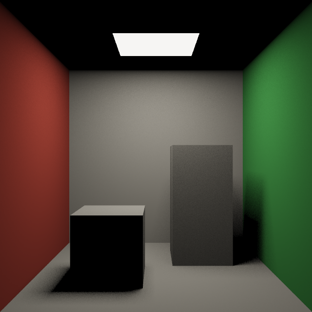
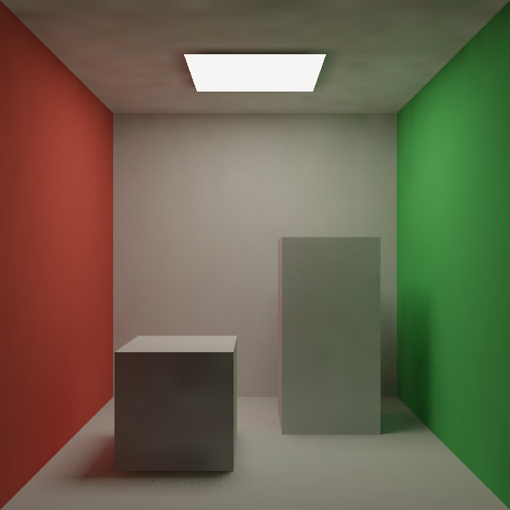

# 最小 Vulkan Surfel GI 教学示例

用原生 Vulkan **Ray Query** 查询硬件加速结构，在表面 surfel 上计算间接光，再将缓存插值到像素。
这是参考 Webgiya 思路从零写的独立教学示例，采用 C++17 + GLSL，不依赖 Three.js、窗口库、数学库或模型文件。

**范围：离线输出图片，无窗口与交互。** 省去交换链和光栅管线，集中学习硬件求交、surfel 缓存和 compute dispatch。
surfels 的积分与最后的像素着色都在 GPU 上完成，CPU 不做光线求交。

| 仅直接光 | 直接光 + Surfel GI |
| --- | --- |
|  |  |

## 运行

需要 Vulkan SDK、CMake、Ninja、C++17 编译器，以及支持 Vulkan 1.2、Ray Query 的 GPU/驱动。
Windows 可在 Visual Studio 的 Developer PowerShell 中执行：

```powershell
git clone https://github.com/gula00/Surfel.git
cd Surfel
.\run.ps1 -Validate
```

脚本构建程序、开启 Vulkan 标准验证和同步验证，并生成：

- `direct.png`：仅面积灯的直接光。
- `gi.png`：相同直接光，加 surfel 缓存得到的间接光。
- 同名 BMP 是 C++ 程序的原始输出；PNG 由 Windows 的 System.Drawing 转换，无需额外图像包。

也可手动构建和运行。程序使用绝对着色器目录，因此可以从任意工作目录启动，图片写到当前工作目录：

```powershell
cmake -S . -B build -G Ninja -DCMAKE_BUILD_TYPE=Release
cmake --build build
.\build\surfel_vulkan.exe --validate
```

`--validate` 需要 SDK 的 `VK_LAYER_KHRONOS_validation`；省略此参数可关闭验证。构建好的可执行文件仍需要旁边构建目录中的 SPIR-V 文件，不能只复制 exe。

## 推荐阅读顺序

| 文件 / 入口 | 学习内容 |
| --- | --- |
| `main.cpp` 的 `Scene` | 生成 Cornell Box 的 32 个三角形；在矩形上铺规则 surfel |
| `Vulkan::init` | 选择设备，检查并启用扩展及 feature |
| `Vulkan::buffer` | buffer、显存分配与 device address |
| `Vulkan::buildAS` 及 `main` 的 BLAS/TLAS 部分 | 将三角形交给驱动构建加速结构 |
| `shaders/common.glsl` 的 `trace` / `blocked` | 真正调用硬件 Ray Query 的位置 |
| `shaders/integrate.comp` | 每个 surfel 采样半球，累积间接光 |
| `main` 的 bounce 循环 | dispatch、ping-pong 缓冲区、内存屏障 |
| `shaders/resolve.comp` | 每像素主射线、缓存插值、与直接光合成 |

## 一次运行做什么

```text
CPU：生成矩形、三角形、surfel -> 上传缓冲区
GPU：构建 BLAS（三角形）-> 构建 TLAS（一个 BLAS 实例）

Compute Integrate，第 1 轮：读 cache[0]（全零）-> 写 cache[1]
Compute Integrate，第 2 轮：读 cache[1]         -> 写 cache[0]
Compute Integrate，第 3 轮：读 cache[0]         -> 写 cache[1]
                          每轮之间有内存屏障

Compute Resolve：读最终 cache[1]，生成 direct.bmp
Compute Resolve：读最终 cache[1]，生成 gi.bmp
GPU -> CPU 回读像素
```

这里对应文章里“一个 compute pass”的 Vulkan 命令是一次 `vkCmdDispatch`。
Vulkan 中无需创建一个叫 compute pass 的对象：绑定 compute pipeline 和 descriptor 后直接 dispatch。
`integrate.comp` 每个工作组 64 个线程，`(surfelCount+63)/64` 个工作组覆盖全部 surfel。
`resolve.comp` 每组 8×8 个线程，覆盖输出像素。

**dispatch 的先后顺序不等于缓冲区依赖已经同步。** `vkCmdPipelineBarrier` 明确建立前一轮读写与下一轮读写之间的依赖。
每轮从旧缓存读取、向另一个缓存写入，避免线程读到本轮其他线程刚写出的结果。

## 硬件做了什么

本例启用：

- `VK_KHR_acceleration_structure`：创建并构建 BLAS / TLAS。
- `VK_KHR_ray_query`：在普通 compute shader 内查询射线命中。
- `VK_KHR_deferred_host_operations`：加速结构扩展的依赖；本例没有显式使用延迟主机操作。
- Vulkan 1.2 的 `bufferDeviceAddress`：让构建命令通过 GPU 地址读取几何数据。

CPU 录制 `vkCmdBuildAccelerationStructuresKHR`，GPU 执行构建；随后 GLSL 中：

```glsl
rayQueryInitializeEXT(query, scene, flags, mask, origin, tMin, direction, tMax);
while (rayQueryProceedEXT(query)) { }
```

由驱动/硬件处理加速结构遍历与三角形求交。本例**没有软件 BVH 遍历**。
硬件只回答命中信息；方向采样、材质、直接光、光照反弹、缓存和色调映射由我们编写。
这里使用 compute pipeline + Ray Query，所以不需要 `VK_KHR_ray_tracing_pipeline`、SBT 或专用 closest-hit shader。

## 缓存究竟存什么

Lambert 漫反射表面满足 `L_out = emission + albedo * E / pi`。
本例将光照拆为直接与间接两项，cache 存储 **`C = E_indirect / pi`**，尚未乘接收表面的 albedo。

对当前 surfel 采用余弦半球采样，`pdf = cos(theta)/pi`，因此 `C` 的估计就是采样入射 radiance 的平均值：

```text
currentCache(x) = average(
    albedo(hit) * [ directEOverPi(hit) + previousCache(hit) ]
)
```

- 命中灯本身时跳过：灯对当前表面的贡献属于直接光，已由面积灯显式采样计算。
- 命中普通表面时，用该处的直接光和上一轮间接光，计算它反射回来的 radiance。
- 第 1 轮得到一次表面间的间接反弹；后续轮次逐步加入更长路径。
- Resolve 时输出 `emission + albedo * (directEOverPi + cachedGI)`。

`directDiffuse` 在面积灯上均匀采样，以 `面积 * cosSurface * cosLight / (pi * distance²)` 加权，并发遮挡射线。
所有求光计算使用线性 RGB，最终写图时才做 Reinhard 色调映射和近似 gamma 编码。

## 为什么没实现原项目的三维网格

本例只使用互相正交边构成的矩形；CPU 按“每矩形两个三角形”上传，因此 `primitiveIndex/2` 就是表面编号。
命中点投影到矩形的局部 u/v 坐标后，可直接找到其四个相邻 surfel 并双线性插值。
这仍然是真正的表面光照缓存：积分在 surfel 上算，多个像素共享结果。
推广到任意模型时，这个捷径需要换成空间网格或其他表面邻域查询结构。

## 可以动手修改的地方

1. `main` 中 `Samples=256` 改为 16：观察 surfel 噪声；改为 1024：更平滑、计算更多。
2. `Bounces=3` 改为 0、1、3：0 时两个输出一致；1 时已有颜色反弹，3 时暗部更亮。
3. `Scene::quad` 中间距 `0.10f` 改为 `0.20f`：surfel 更少，空间细节更模糊；两个方向的间距要一起改。
4. `Width/Height` 改为 1280：Resolve 工作增加，surfel 数与积分射线数保持原值。
5. 修改红绿墙的 `albedo`：观察地板、天花板与箱子侧面上的颜色变化。

本例不做时域滤波、采样引导、动态 surfel 分配或径向深度遮挡。有限样本会有噪点，低密度缓存在遮挡边界可能过度平滑、产生漏光。
它是离线教学实现；控制台打印的是积分、两次 Resolve 和回读的 CPU 总耗时，不是实时帧率或精确 GPU 耗时。
为简化上传与回读，场景和缓存使用 host-visible coherent 内存；正式项目通常改为 staging 上传到 device-local 内存。

## 本机验证记录

- NVIDIA GeForce RTX 4070 Ti SUPER，驱动 610.88。
- Vulkan SDK 1.4.341.1、MSVC 19.44、Release 构建通过。
- 32 个三角形、2529 个 surfel、每 surfel 256 个样本、3 轮间接光积分。
- 开启 Khronos 标准验证与同步验证，运行结果 `Validation errors: 0`。
- 已检查直接光与 GI 图片：GI 照亮箱子暗面与天花板，并出现红绿墙颜色反弹。
- 环境的 Vulkan loader 另有 OBS 重复注册层提示，不属于本例的 Vulkan 验证错误。

参考：[原文章](https://juretriglav.si/surfel-based-global-illumination-on-the-web/)、[Vulkan Ray Query 示例](https://docs.vulkan.org/samples/latest/samples/extensions/ray_queries/README.html)、[Vulkan BLAS/TLAS 教程](https://docs.vulkan.org/tutorial/latest/courses/18_Ray_tracing/02_Acceleration_structures.html)。
